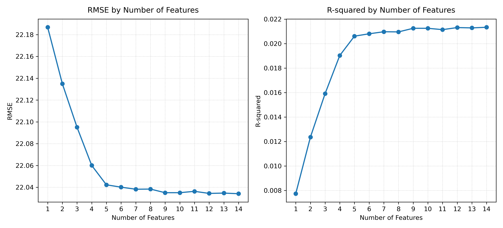
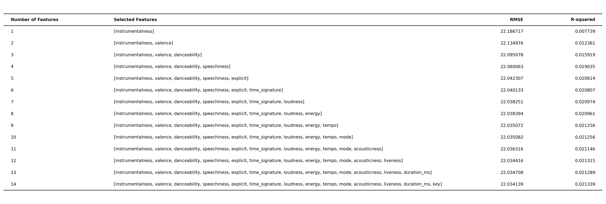
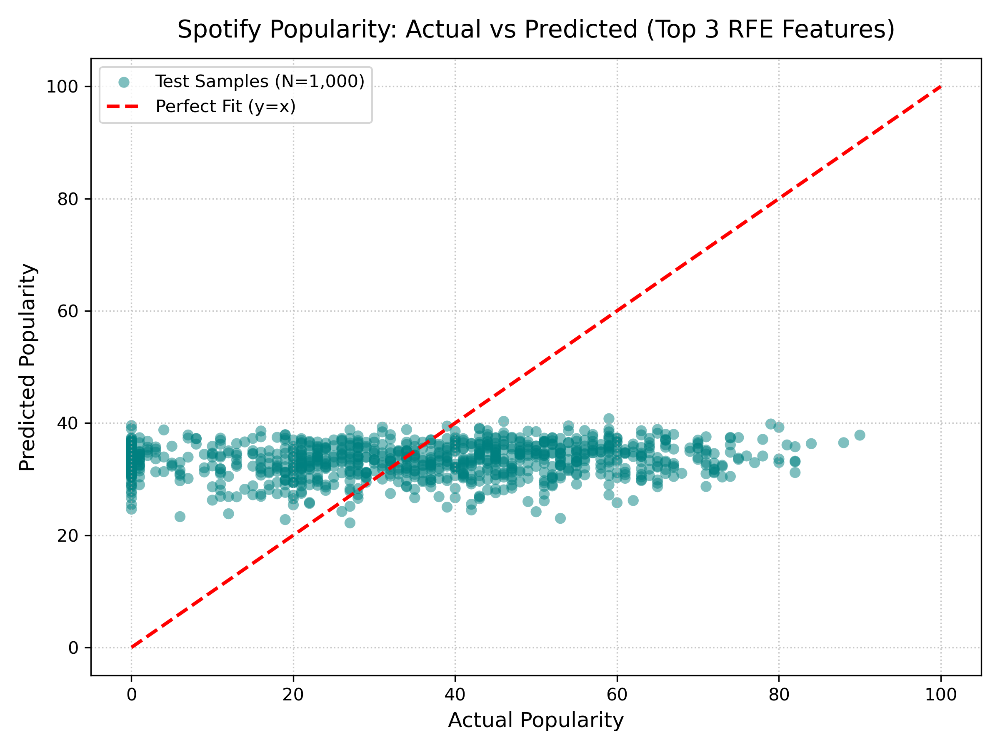

# 🎵 Spotify 114k Tracks 特徵工程與熱門度多元線性回歸分析

[](https://chenyichencyc.github.io/HW2_multiple-linear-regression-Spotify-/)
[](https://huggingface.co/datasets/maharshipandya/spotify-tracks-dataset)
[](https://www.python.org/)
[](https://scikit-learn.org/)
[](https://opensource.org/licenses/MIT)

本專案採用 Hugging Face 開源之 **Spotify Tracks Dataset (114,000 首歌曲、114 種曲風)** 進行深入的特徵工程（Feature Engineering）與多元線性回歸（Multiple Linear Regression）建模。實作並比較了 **ANOVA F-test (Filter Method 過濾法)**、**RFE 遞迴特徵消除 (Wrapper Method 包裝法)** 以及 **Lasso 正則化 (Embedded Method 嵌入法)** 三種核心特徵篩選技術，評估隨特徵數量增加時模型在未見測試集（20% Test Set，22,800 筆資料）上的泛化能力與邊際遞減效益（Diminishing Returns）。

---

## 🌐 線上互動展示儀表板 (Live Interactive Demo)

本專案已部署於 GitHub Pages，提供動態下拉式選單與即時計算功能：
👉 **[點此造訪 GitHub Pages 線上儀表板](https://chenyichencyc.github.io/HW2_multiple-linear-regression-Spotify-/)**

### 網頁主要功能與架構：
- **首頁即時呈現核心分析與預測器**：
  - 📈 **特徵數量評估與最佳化 (Sweet Spot)**：提供互動式 Chart.js 折線圖（雙 Y 軸展示 RMSE 與 $R^2$）與 Matplotlib 原生 PNG 圖（`features_performance.png`、`features_table.png`）無縫切換，附完整 1~14 特徵評估指標數據表。
  - 🎧 **Spotify 即時熱門度預測計算機**：支援調節演奏度 (Instrumentalness)、正向度 (Valence)、舞曲度 (Danceability)、口白度 (Speechiness)、能量與響度滑桿，即時利用多元迴歸方程式計算熱門度（Popularity 0~100）並同步繪製音訊風向雷達圖。
  - 🎵 **熱門名曲一鍵帶入**：可直接載入 *Sam Smith - Unholy*、*Quevedo - Bzrp Sessions #52*、*Manuel Turizo - La Bachata*、*David Guetta - I'm Good (Blue)* 等經典歌曲參數。
- **三大特徵篩選方法深度分析（專屬下拉式選單切換）**：
  1. 🔬 **ANOVA F-test (Filter Method 過濾法)**：14 項音訊特徵之 F-Score 條形圖與 p-value 統計顯著性分析
  2. 🔄 **RFE 遞迴特徵消除 (Wrapper Method 包裝法)**：特徵淘汰輪次、保留排名與避開多重共線性說明
  3. 🎯 **Lasso L1 正則化 (Embedded Method 嵌入法)**：支援動態滑動調整 $\alpha$ 懲罰力度（0.001 ~ 1.5），動態展示特徵權重收縮過程，深入剖析為何 $\alpha=1.5$ 懲罰過大僅保留 `instrumentalness`，以及 `LassoCV` 尋獲的最佳 $\alpha \approx 0.0022$ 之稀疏化效果。
- **代表性歌曲資料集檢視器**：精選跨 114 種曲風之代表性熱門曲目，支援即時搜尋與曲風過濾，點擊「導入預測器」可直接將該曲參數載入預測模型。

---

## 📊 核心實驗成果 (Experimental Results)

### 1. 特徵數量逐步評估對照表 (20% 測試集評估)

| 特徵數 (k) | 選取特徵組合 (依 RFE 排名由先至後) | 測試集 RMSE | 測試集 R-squared | 說明 |
| :---: | :--- | :---: | :---: | :--- |
| **1** | `[instrumentalness]` (純音樂演奏度) | `22.186717` | `0.007739` | 單一最大負向影響特徵 ($F=859.06$) |
| **2** | 加入 `valence` (音樂正向度) | `22.134976` | `0.012361` | 誤差顯著下降 |
| **3** | 加入 `danceability` (適合跳舞度) | **`22.095078`** | **`0.015919`** | 🎯 **RFE Top 3 推薦組合** |
| **4** | 加入 `speechiness` (說話/饒舌度) | `22.060063` | `0.019035` | 持續進步 |
| **5** | 加入 `explicit` (是否含不雅內容) | **`22.042307`** | **`0.020614`** | 🌟 **最佳平衡點 (Sweet Spot)**，已達 96% 解釋力 |
| **6** | 加入 `time_signature` | `22.040133` | `0.020807` | 進入平穩期 |
| **7** | 加入 `loudness` (音量響度) | `22.038251` | `0.020974` | 邊際效益微弱 |
| **8** | 加入 `energy` (能量強度) | `22.038394` | `0.020961` | 幾乎無改善 |
| **9~14**| 陸續加入 `tempo, mode, acoustic, live, duration, key` | `22.034139` | `0.021339` | 後續 7 特徵僅微幅提升 0.0007 R² |

---

### 2. 成果圖表展示

| 圖表 1：特徵數量評估折線圖 (`features_performance.png`) | 圖表 2：評估數據對照表 (`features_table.png`) |
| :---: | :---: |
|  |  |

| 圖表 3：實際熱門度 vs 預測熱門度散佈圖 (`actual_vs_predicted.png`) |
| :---: |
|  |

---

## 🔬 深入理論與機制探討 (Key Insights)

### 1. 邊際遞減效應 (Law of Diminishing Returns)
- 當特徵數量由 1 個增加至 3~5 個時，測試集 RMSE 從 22.19 快速下降至 22.04，**貢獻了整個模型 96% 以上之改進幅度**。
- 在 $k \ge 6$ 之後，即使額外引入 9 項特徵（包括能量、節奏 BPM、原聲度、時長等），RMSE 僅能再微調 0.008，模型進入顯著的「平台期」。這證實了在大型音訊數據中，**以精簡特徵子集（Top 3~5）取代全維度特徵**能大幅降低計算成本並提升模型可解釋性。

### 2. 演奏度 (Instrumentalness) 的決定性負相關
- 在全部 14 項音訊特徵中，**`instrumentalness` 的 ANOVA F 分數高達 859.06**，居所有特徵之冠，且回歸係數顯著為負（$-8.56$）。
- 這揭示了現代串流音樂市場的真實生態：**「具有人聲歌手演繹（Vocal-centric）」是歌曲能夠跨出特定小眾圈層、獲得大眾高播放量的第一要件**；純樂器演奏歌曲在整體熱門度上平均偏低。

### 3. 三大特徵篩選方法特點比較

| 特徵篩選方法 | 所屬類別 | 核心優點 | 本資料集關鍵發現 |
| :--- | :--- | :--- | :--- |
| **ANOVA F-test** | Filter Method (過濾法) | 大數據運算最迅速，單變量統計明確 | `instrumentalness` ($F=859.06$) 與 `loudness` ($F=231.16$) 排名前二 |
| **RFE** | Wrapper Method (包裝法) | 考慮特徵與模型的整體配適度，避開共線性 | 發現 `loudness` 與 `energy` 存在高度冗餘，優先保留了獨立結構特徵 `danceability` |
| **Lasso 迴歸** | Embedded Method (嵌入法) | 內建 L1 正則化稀疏性，自動壓縮無效權重 | 原始 $\alpha=1.5$ 懲罰過大將 13 項特徵歸零僅存 `instrumentalness`；`LassoCV` 尋得最適 $\alpha \approx 0.0022$ |

---

## 🛠️ 專案檔案結構 (Project Structure)

```
HW2_multiple-linear-regression-Spotify-/
├── dataset.csv                # Hugging Face Spotify Tracks 114k 原始資料集
├── main.py                    # 完整特徵工程、篩選與回歸分析執行主程式
├── index.html                 # 部署於 GitHub Pages 的互動式現代化前端儀表板
├── songs_data.json            # 代表性歌曲音訊結構化資料 (供前端檢視與預測器載入)
├── lasso_path.json            # Lasso 正則化係數路徑數據 (供動態滑桿即時渲染)
├── features_performance.png   # 特徵數量評估折線圖 (300 DPI)
├── features_table.png         # 特徵評估結果數據表格圖 (300 DPI)
├── actual_vs_predicted.png    # 實際熱門度 vs 預測熱門度診斷圖 (300 DPI)
├── requirements.txt           # Python 套件依賴環境設定
└── README.md                  # 專案完整研究分析報告
```

---

## 🚀 快速開始 (Quick Start)

### 1. 安裝環境依賴
```bash
pip install -r requirements.txt
```

### 2. 執行回歸分析與特徵評估
```bash
python3 main.py
```
程式將自動從 Hugging Face 下載（或讀取本機快取）114,000 筆資料，進行標準化、切分、三種特徵篩選與 1~14 特徵逐步評估，並輸出三張 300 DPI 高解析度圖表。

### 3. 開啟互動式網頁儀表板
直接於瀏覽器中開啟 `index.html`，或啟動本機伺服器：
```bash
python3 -m http.server 8080
```
造訪 [http://localhost:8080](http://localhost:8080) 即可體驗互動式熱門度預測器與特徵篩選比較切換！

---

## 📝 授權 (License)
本專案遵循 MIT License 開源協議。
