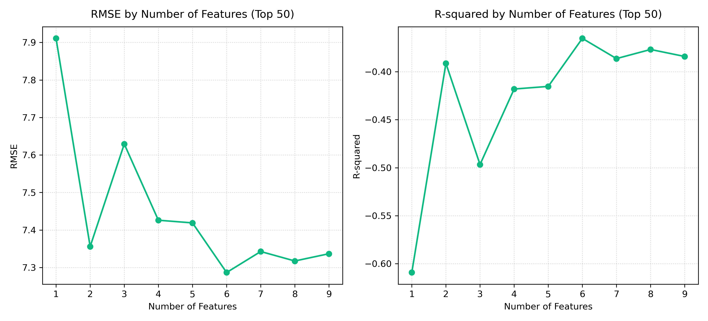
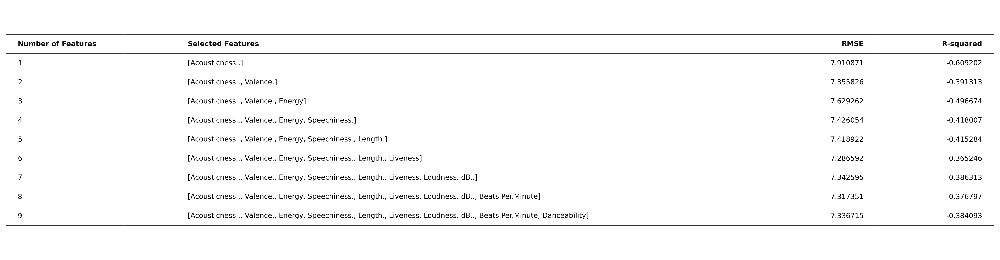
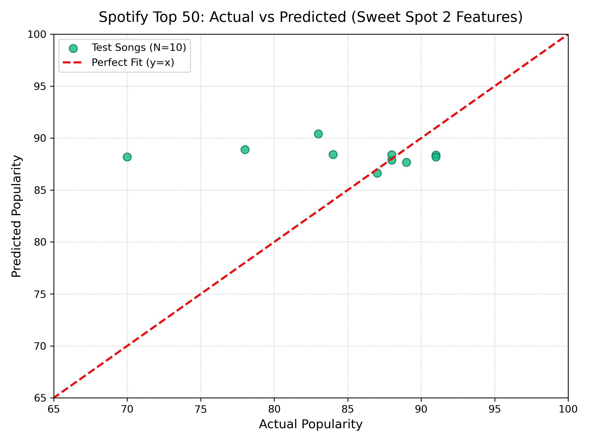

# 🎵 Spotify 音訊特徵工程與熱門度多元回歸分析 (雙資料集對比研究)

[](https://chenyichencyc.github.io/HW2_multiple-linear-regression-Spotify-/)
[](https://huggingface.co/datasets/maharshipandya/spotify-tracks-dataset)
[-1ed760?style=for-the-badge&logo=spotify)](https://raw.githubusercontent.com/CarlHatoum/Spotify-TOP-50-songs/master/top50.csv)
[](https://www.python.org/)
[](https://scikit-learn.org/)
[](https://opensource.org/licenses/MIT)

本專案以 **Spotify 音樂熱門度預測** 為核心主題，嚴謹探討並對比了兩種截然不同規模與分佈的真實音樂資料集：
1. **全球音樂母體庫 (114,000 首 · Hugging Face)**：真實世界長尾分佈，探討海量樣本中的「回歸均值現象」(Regression to the Mean) 與聲學指標的解釋力極限。
2. **全球 Top 50 爆款排行 (50 首 · CarlHatoum/top50)**：告示牌排行榜精選，探討小樣本在「倖存者偏差」(Survivorship Bias) 下的過擬合現象與高分聚集特性。

全面實作並比較了 **ANOVA F-test (Filter Method 過濾法)**、**RFE 遞迴特徵消除 (Wrapper Method 包裝法)** 以及 **Lasso 正則化 (Embedded Method 嵌入法)** 三大特徵篩選技術。

---

## 🌐 線上互動展示儀表板 (Live Interactive Demo)

本專案已部署於 GitHub Pages，於全站頂部導覽列提供**專屬資料集切換選單與快捷按鈕**，隨時無縫切換雙資料集進行深度對比：
👉 **[點此造訪 GitHub Pages 線上儀表板](https://chenyichencyc.github.io/HW2_multiple-linear-regression-Spotify-/)**

### 網頁主要功能與特色：
- **頂部雙資料集導覽列 (Global Dataset Switcher)**：
  - 支援以**下拉式選單**與**快捷按鈕**隨時切換：
    - 🎵 **1. 全球音樂母體庫 (114,000 首 · Hugging Face)**
    - 🔥 **2. 全球 Top 50 爆款排行 (50 首 · CarlHatoum/top50)**
  - 支援 URL Hash（`#114k` 與 `#top50`）以及 `localStorage` 記憶狀態。
- **各自專屬的完整分析模組**：
  - 📈 **特徵數量評估與最佳化 (Sweet Spot)**：提供互動式 Chart.js 折線圖（雙 Y 軸展示 RMSE 與 $R^2$）與 Matplotlib 原生圖表無縫切換。
  - 🎧 **即時熱門度預測器**：提供滑桿調節參數、動態多元回歸計算機、聲學雷達圖與名曲一鍵導入。
  - 🔬 **三大特徵篩選方法**：ANOVA 條形圖、RFE 淘汰排名表、以及可動態調節 $\alpha$ 懲罰強度的 Lasso 權重路徑圖。
  - 🎵 **資料集名曲檢視器**：支援歌曲搜尋、曲風分類過濾與一鍵導入預測器。

---

## 📊 雙資料集深度對比與核心發現 (Comparative Analysis)

| 比較維度 | 資料集 1：全球母體庫 (114,000 首) | 資料集 2：Top 50 爆款排行 (50 首) |
| :--- | :--- | :--- |
| **資料來源** | Hugging Face `spotify-tracks-dataset` | GitHub `CarlHatoum/Spotify-TOP-50-songs` |
| **樣本規模** | 114,000 筆 (涵蓋 114 種曲風) | 50 筆 (2019 全球最夯單曲) |
| **特徵維度** | 14 維數值特徵 | 9 維數值特徵 |
| **平均熱門度 (Mean)**| **`33.24` 分** (長尾常態偏右分佈) | **`87.50` 分** (高分強烈集中) |
| **截距項 (Intercept)** | **`~34.26`** (回歸均值) | **`~89.74`** (爆款基準分) |
| **模型決定係數 ($R^2$)**| $R^2 \approx 0.021$ (聲學解釋力微弱) | 訓練集 $R^2 \approx 0.285$，測試集易過擬合 |
| **最佳特徵數 (Sweet Spot)**| **3~5 個特徵** (96% 線性效益) | **2 個特徵** (Valence + Speechiness) |
| **核心關鍵特徵** | 演奏度 ($-$), 正向度 ($-$), 舞曲度 ($+$) | 正向度 ($-$), 說唱度 ($+$), 現場感 ($+$) |
| **統計現象解析** | **回歸均值 (Regression to the Mean)** | **倖存者偏差 (Survivorship Bias)** |

### 💡 核心洞見：為什麼預測分數截然不同？
1. **全球母體庫 (114k)**：
   - 包含海量冷門獨立音樂、環境白噪音與未宣傳歌曲，母體平均熱門度僅 33 分。
   - 由於歌曲能否爆紅受到社群傳播 (TikTok/Instagram)、藝人知名度與唱片公司宣傳預算等非聲學特徵主導，純聲學回歸模型必定會產生經典的**回歸均值現象**，因此預測分數多自然聚攏在 20~45 分區間。
2. **Top 50 榜單 (50 首)**：
   - 能登上榜單的歌曲本身就是歷經市場殘酷淘選後的「倖存者」，平均熱門度高達 87.5 分。
   - 模型截距高達 89.7 分，因此預測分數自然多落在 80~95 分的爆款區間；但因樣本規模小，一旦特徵超過 2~3 個即面臨過擬合與變異劇增。

---

## 📈 成果圖表展示 (Artifacts)

### 資料集 1：Hugging Face 114k 母體庫
| 特徵數量評估折線圖 (`features_performance.png`) | 評估數據對照表 (`features_table.png`) | 實際 vs 預測散佈圖 (`actual_vs_predicted.png`) |
| :---: | :---: | :---: |
|  |  |  |

### 資料集 2：CarlHatoum Top 50 爆款排行
| Top 50 特徵評估折線圖 (`top50_features_performance.png`) | Top 50 評估數據對照表 (`top50_features_table.png`) | Top 50 實際 vs 預測圖 (`top50_actual_vs_predicted.png`) |
| :---: | :---: | :---: |
|  |  |  |

---

## 🛠️ 專案檔案結構 (Project Structure)

```
HW2_multiple-linear-regression-Spotify-/
├── dataset.csv                     # Hugging Face Spotify Tracks 114k 原始資料集
├── top50.csv                       # CarlHatoum Spotify Top 50 2019 原始資料集
├── main.py                         # 完整支援雙資料集執行之特徵工程與回歸主程式
├── index.html                      # 部署於 GitHub Pages 的雙資料集切換前端儀表板
├── songs_data.json                 # 114k 代表性歌曲資料
├── top50_songs_data.json           # Top 50 榜單歌曲資料
├── lasso_path.json                 # 114k Lasso 正則化係數路徑
├── top50_lasso_path.json           # Top 50 Lasso 正則化係數路徑
├── features_performance.png        # 114k 特徵評估圖
├── features_table.png              # 114k 特徵表格圖
├── actual_vs_predicted.png         # 114k 散佈診斷圖
├── top50_features_performance.png  # Top 50 特徵評估圖
├── top50_features_table.png        # Top 50 特徵表格圖
├── top50_actual_vs_predicted.png   # Top 50 散佈診斷圖
├── requirements.txt                # Python 套件依賴環境設定
└── README.md                       # 專案完整研究分析報告
```

---

## 🚀 快速開始 (Quick Start)

### 1. 安裝環境依賴
```bash
pip install -r requirements.txt
```

### 2. 執行回歸分析與特徵評估
```bash
# 同時執行兩大資料集分析並輸出對比
python3 main.py

# 亦可單獨執行特定資料集
python3 main.py --dataset 114k
python3 main.py --dataset top50
```

### 3. 開啟互動式網頁儀表板
直接於瀏覽器中開啟 `index.html`，或啟動本機伺服器：
```bash
python3 -m http.server 8080
```
造訪 [http://localhost:8080](http://localhost:8080) 即可自由切換雙資料集進行互動體驗！

---

## 📝 授權 (License)
本專案遵循 MIT License 開源協議。
